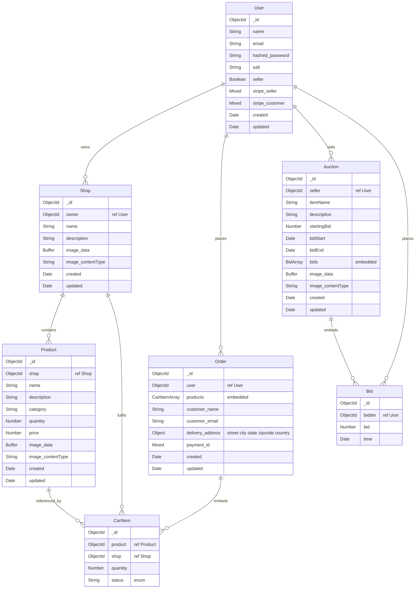
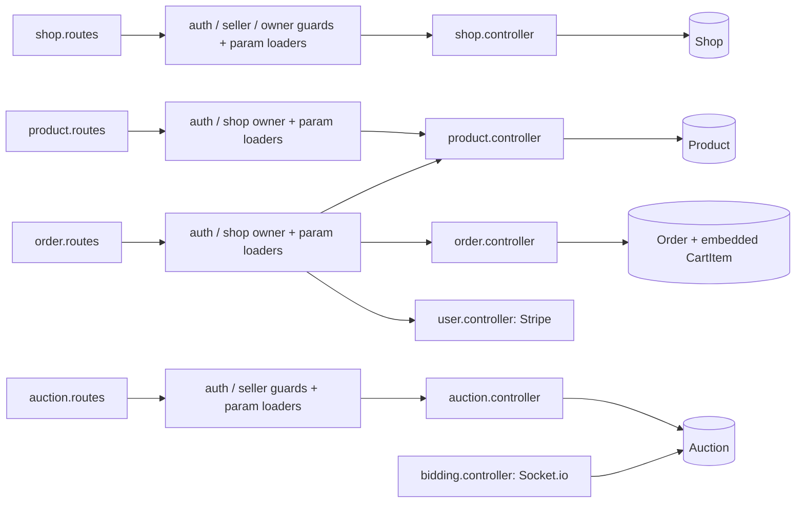

# Domain model and request sequences

Phase 1 (system understanding) for the shop, product, order and auction modules. Unless marked
otherwise, diagrams and `file:line` references describe tag `baseline` (`bf3fc45`). See
[Architecture and request lifecycle](architecture.md) for the backend core and its after-refactoring
views. References can be checked with `git show baseline:<path> | nl -ba`.

## 1. Data model (baseline)



Cardinalities express intended relationships, not enforced foreign keys: the reference fields are
not marked required and Mongoose does not enforce referential integrity. `image_data` and
`image_contentType` above are nested `image.data` and `image.contentType`, not flat schema paths.
`CartItemArray` and `BidArray` label embedded arrays rather than separate collections.

Design observations:

- Shop, product and auction images are Buffers inside MongoDB documents
  (`server/models/shop.model.js:8`, `server/models/product.model.js:8`,
  `server/models/auction.model.js:12`).
- `stripe_seller`, `stripe_customer` and `payment_id` use untyped `{}` schema declarations
  (`server/models/user.model.js:30`, `server/models/order.model.js:31`).
- Shop deletion has no product cascade (`server/controllers/shop.controller.js:93`);
  `Product.shop` is only a reference (`server/models/product.model.js:32`).
- Orders embed `CartItemSchema`; CartItem is also registered as a model solely for reading its
  status enum in the domain code (`server/models/order.model.js:10`,
  `server/controllers/order.controller.js:44`). Values are `Not processed`, `Processing`, `Shipped`,
  `Delivered`, `Cancelled`; the default is `Not processed`.
- Bids are embedded in newest accepted bid order, with the highest bid at index 0
  (`server/models/auction.model.js:34`, `server/controllers/bidding.controller.js:18`).

## 2. Module and feature map (baseline)



| Module / routes file | Middleware and param loaders | Controller → model |
|---|---|---|
| `server/routes/shop.routes.js` | Creation: requireSignin → hasAuthorization → userCtrl.isSeller; mutations: requireSignin → isOwner. `shopId` → shopByID → req.shop; `userId` → userByID → req.profile (`:14`, `:18`, `:28`). | shop.controller → Shop; public catalogue, detail and logo; owner listing and CRUD |
| `server/routes/product.routes.js` | Creation/mutations: requireSignin → shopCtrl.isOwner. `shopId` → shopByID; `productId` → productByID → req.product (`:8`, `:32`, `:36`). | product.controller → Product; CRUD, catalogue/search, categories, latest, related, images and stock |
| `server/routes/order.routes.js` | Checkout: requireSignin → stripeCustomer → decreaseQuantity. Seller routes: requireSignin → shopCtrl.isOwner, then charge or stock middleware where applicable. `userId`, `shopId`, `productId`, `orderId` → their loaders; orderByID sets req.order (`:10`, `:22`, `:25`, `:34`). | order.controller → Order / CartItem; product.controller → Product; user.controller → User / Stripe |
| `server/routes/auction.routes.js` | Creation: requireSignin → hasAuthorization → userCtrl.isSeller; mutations: requireSignin → auctionCtrl.isSeller. `auctionId` → auctionByID → req.auction; `userId` → userByID (`:17`, `:21`, `:31`). | auction.controller → Auction; open/seller/bidder listing, CRUD and images |
| `server/controllers/bidding.controller.js` | Socket room join/leave and new bid; no authentication (`:3`). | Socket event handler → Auction.findOneAndUpdate |

Param loaders run before route middleware. The product loader populates `shop` with `_id name`
(`server/controllers/product.controller.js:36`); shop and auction loaders populate their owners
(`server/controllers/shop.controller.js:36`, `server/controllers/auction.controller.js:36`).

## 3. Checkout sequences (baseline)

### 3.1 Buyer places an order

```mermaid
sequenceDiagram
  autonumber
  participant C as client/cart/PlaceOrder.js
  participant Stripe as Stripe API
  participant E as Express / order.routes
  participant U as userCtrl.stripeCustomer
  participant DB as User / MongoDB
  participant P as productCtrl.decreaseQuantity
  participant O as orderCtrl.create
  C->>Stripe: stripe.createToken()
  Stripe-->>C: token.id
  C->>E: POST /api/orders/:userId {token, order}
  E->>E: userByID loads req.profile; requireSignin verifies JWT
  E->>U: req.profile, token, order
  alt existing stripe_customer
    U->>Stripe: customers.update(customerId, source)
    Stripe-->>U: customer
  else new customer
    U->>Stripe: customers.create(email, source)
    Stripe-->>U: customer
    U->>DB: User.update $set stripe_customer = customer.id
    DB-->>U: saved
  end
  U->>U: order.payment_id = customer.id
  U->>P: next()
  P->>P: Product.bulkWrite(updateOne $inc quantity by -item.quantity)
  P->>O: next()
  O->>O: order.user = req.profile; new Order(order).save()
  O-->>C: 200 saved order
  C->>C: emptyCart; Redirect to /order/:orderId
```

Evidence: `client/cart/PlaceOrder.js:49` and `:71`, `client/order/api-order.js:1`,
`server/routes/order.routes.js:10`, `server/controllers/user.controller.js:118`,
`server/controllers/product.controller.js:166`, `server/controllers/order.controller.js:4`.
The diagram follows the successful path. Baseline checkout has no hasAuthorization check and no
transaction spanning customer persistence, stock decrease and order creation.

### 3.2 Seller charges and updates an item

```mermaid
sequenceDiagram
  autonumber
  participant C as Seller client
  participant E as Express / order.routes
  participant G as requireSignin / shopCtrl.isOwner
  participant U as userCtrl.createCharge
  participant S as Stripe connected account
  participant O as orderCtrl.update
  participant DB as Order / MongoDB
  C->>E: PUT /api/order/:orderId/charge/:userId/:shopId {amount, cartItemId, status}
  E->>E: Load orderId, userId and shopId with router.param
  E->>G: verify JWT; check req.shop.owner._id == req.auth._id
  G->>U: next()
  U->>U: require req.profile.stripe_seller
  U->>S: tokens.create(customer = req.order.payment_id, stripeAccount)
  S-->>U: token
  U->>S: charges.create(amount * 100, usd, token.id, stripeAccount)
  S-->>U: charge
  U->>O: next()
  O->>DB: updateOne(products._id = cartItemId, products.$.status = status)
  DB-->>O: update result
  O-->>C: 200 update result
```

Evidence: `server/routes/order.routes.js:25`, `server/controllers/shop.controller.js:127`,
`server/controllers/user.controller.js:152`, `server/controllers/order.controller.js:31`.

## 4. Live bidding sequence (baseline)

```mermaid
sequenceDiagram
  autonumber
  participant C as Client Bidding.js
  participant B as bidding.controller / Socket.io
  participant DB as Auction / MongoDB
  participant R as Each client in room
  C->>B: join auction room {room}
  B->>B: socket.join(room)
  C->>B: new bid {room, bidInfo: {bid, time, bidder}}
  B->>B: bid(data.bidInfo, data.room)
  B->>DB: findOneAndUpdate(_id, $or: top bid < bid OR bids == [])
  Note over B,DB: $push bids with $each:[bid], $position:0; new:true
  DB->>DB: populate bids.bidder and seller (_id name)
  alt accepted bid
    DB-->>B: updated auction
    B-->>R: io.to(room).emit('new bid', result)
    R->>R: props.updateBids(result) → setAuction(result)
  else rejected bid
    DB-->>B: null
    B-->>R: io.to(room).emit('new bid', null)
    R->>R: props.updateBids(null) → setAuction(null)
    Note over R: BUG-4: render reads auction._id; page crashes
  end
  C->>B: leave auction room {room}
  B->>B: socket.leave(room)
```

Evidence: `client/auction/Bidding.js:36`, `:45`, `:56`;
`server/controllers/bidding.controller.js:6`, `:16`; `client/auction/Auction.js:89` and `:95`.
The query does not check the auction window, starting bid or socket identity. Schema casting is not
an explicit bid validation policy; rejected amounts and query errors follow different paths.

## 5. Design patterns in the domain modules

- **MVC layering:** React views call REST routes; controllers operate on Mongoose models. The shop
  route imports its controller (`server/routes/shop.routes.js:4`), which imports and saves Shop
  (`server/controllers/shop.controller.js:1`, `:24`). The baseline controller also performs data
  access and upload work, so responsibilities are only partly separated.
- **Middleware chain / Chain of Responsibility:** handlers can reject a request or pass it onwards
  using next(). A shop update chains requireSignin → isOwner → update
  (`server/routes/shop.routes.js:19`, `server/controllers/shop.controller.js:127`).
- **router.param loaders:** shared lookup logic attaches documents before the route chain
  (`server/routes/product.routes.js:36`, `server/controllers/product.controller.js:34`).
- **Observer / pub-sub:** room membership selects subscribers and Socket.io broadcasts auction
  changes (`server/controllers/bidding.controller.js:6`, `:22`); clients register a listener and
  update React state (`client/auction/Bidding.js:45`, `client/auction/Auction.js:89`).

## 6. Defects in this area (baseline)

Candidate IDs need team confirmation before the corresponding fixes are committed.

| ID | Defect | Baseline evidence |
|---|---|---|
| D-01 | Repeated multipart, image/read and ownership logic | `server/controllers/shop.controller.js:8`, `:50`, `:127`; parallel blocks in `server/controllers/product.controller.js:8`, `:50` and `server/controllers/auction.controller.js:8`, `:50`, `:138` |
| D-04 | Controllers combine HTTP, business operations and persistence without services | `server/controllers/product.controller.js:150`, `:166`; `server/controllers/order.controller.js:4` |
| D-05 | Socket server setup, event handling and bid persistence live in a controller | `server/controllers/bidding.controller.js:3`, `:16` |
| BUG-1 | Shop and auction remove() promises are sent without awaiting deletion | `server/controllers/shop.controller.js:96`; `server/controllers/auction.controller.js:96` |
| BUG-2 | Upload error responses do not return, allowing save and a second response | `server/controllers/shop.controller.js:12`, `:70`; `server/controllers/auction.controller.js:12`, `:70` |
| BUG-4 (candidate) | Rejected bid returns null, broadcast to all clients, then stored as auction state | `server/controllers/bidding.controller.js:18`, `:24`; `client/auction/Auction.js:89`, `:95` |
| D-14 (candidate) | Product update/delete and cancellation restock check shop ownership but never bind productId to shopId | `server/routes/product.routes.js:32`; `server/routes/order.routes.js:22`; `server/controllers/product.controller.js:75`, `:185` |
| D-15 (candidate) | Item status update filters by item id alone, without the owning shop | `server/controllers/order.controller.js:33` |
| D-16 (candidate) | Bid query omits bidStart, bidEnd, startingBid and explicit amount validation | `server/controllers/bidding.controller.js:18`; UI checks in `client/auction/Bidding.js:68` |
| D-17 (candidate) | Shop deletion leaves Product documents referencing a missing shop | `server/controllers/shop.controller.js:93`; `server/models/product.model.js:32` |

## 7. After backend-core changes (current HEAD)

The domain design above is the baseline, not a claim that all original routes remain unchanged.
Member A moved Stripe operations to `server/controllers/payment.controller.js` and
`server/services/payment.service.js`. Current `server/routes/order.routes.js` uses paymentCtrl for
checkout and charging, adds hasAuthorization to checkout and user order listing, and protects order
reads with requireSignin and isBuyerOrSeller. Those changes must remain intact during domain work.
The domain service extraction and fixes in the table are future work in this Phase 1 document;
no domain runtime behaviour changes accompany it.
