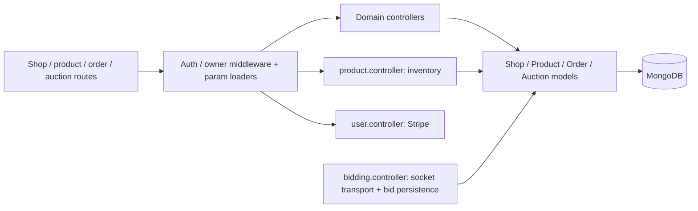
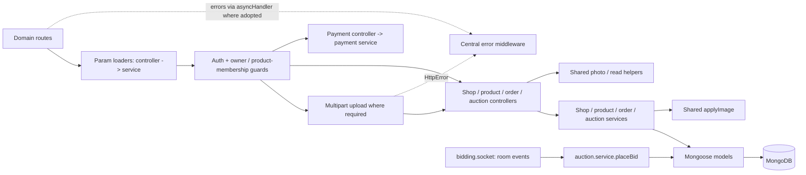

# Member B: domain modules

## 1. Scope

This section covers shop, product, order and auction controllers, models and routes; the original bidding controller; and the new domain services, upload/ownership middleware, image helper and bidding socket. Changes are recorded in commits `3638fa0` through `b5295dd`; the source measured by the final reports is `b5295dd`. Backend-core auth, payment and central error infrastructure remain Member A's work. Client files were not edited by the domain changes; inherited frontend changes are identified in [the comparison](../reports/COMPARISON.md).

## 2. Original design

At `baseline` (`bf3fc45`), routes chained authentication and ownership checks into controllers that called Mongoose directly. Controllers also parsed multipart uploads and copied image Buffers. Bidding combined socket setup, room events and auction persistence in one module (`server/controllers/shop.controller.js:8`, `server/controllers/product.controller.js:166`, `server/controllers/bidding.controller.js:3`, all at baseline).



See [Domain model and request sequences](domain-model.md) for the ER diagram, embedded CartItem/bid relationships, checkout and bidding sequences, and baseline file references. [Architecture and request lifecycle](architecture.md) supplies the wider SSR/REST context. Member A subsequently moved Stripe to payment controller/service (`7d83726`), and its middleware chains were retained.

## 3. Defects and baseline evidence

All references in this table describe `baseline`; they can be reproduced with `git show baseline:<path> | nl -ba`.

| ID | Defect | Evidence | Principle |
|---|---|---|---|
| D-01 | Repeated upload, image/read and ownership code | `server/controllers/shop.controller.js:8`, `:50`, `:127`; `server/controllers/auction.controller.js:138` | DRY |
| D-02 | Repeated error response blocks | `server/controllers/order.controller.js:24`; `server/controllers/product.controller.js:178` | DRY; centralized error handling |
| D-04 | Persistence and inventory mixed with HTTP handling | `server/controllers/order.controller.js:4`; `server/controllers/product.controller.js:166` | SRP; layering |
| D-05 | Socket transport and bid query in a controller | `server/controllers/bidding.controller.js:3`, `:18` | SRP; layering |
| D-07 | Upload errors use message while model errors use error | `server/controllers/shop.controller.js:13`, `:27` | Contract consistency |
| BUG-1 | Unawaited shop/auction removal | `server/controllers/shop.controller.js:96`; `server/controllers/auction.controller.js:96` | Correctness |
| BUG-2 | Parse error response falls through into document work | `server/controllers/shop.controller.js:13`, `:71`; `server/controllers/auction.controller.js:13`, `:71` | Correctness |
| BUG-4 | Rejected query result null is broadcast to the room | `server/controllers/bidding.controller.js:18`, `:24` | Reliability |
| D-14 | Shop ownership is checked without product membership | `server/routes/product.routes.js:32`; `server/routes/order.routes.js:22` | Security |
| D-15 | Status update filters only by cart item id | `server/controllers/order.controller.js:33` | Security |
| D-16 | Bid query lacks amount/window/starting-price policy | `server/controllers/bidding.controller.js:18` | Correctness |
| D-17 | Shop removal leaves its products | `server/controllers/shop.controller.js:93`; `server/models/product.model.js:32` | Data integrity |

## 4. Changes and evidence

The metrics below compare baseline with final source, not isolated measurements after each commit. [COMPARISON.md](../reports/COMPARISON.md) contains complete per-file tables, clone locations, dependency counts and tool limitations. Security and reliability claims rely on the cited regression tests rather than static maintainability scores.


### 4.1 D-01: shared upload, image and ownership functions

**Extract Function** and parameterize common behavior: `5be5ea9` introduced `parseMultipart` and `applyImage`; `f142ed5` shared photo/default/read handlers; `92aa31d` introduced `requireOwner(key, ownerField)`. Controllers retain their exported route-facing names. Auth checks precede upload parsing (`server/routes/shop.routes.js`, `server/routes/product.routes.js`, `server/routes/auction.routes.js`). The ownership helper retains the existing loose comparison (`server/middleware/ownership.js:2`).

This improves maintainability and modifiability by centralizing repeated operations. B clone pairs fell from 10 to 3 and area duplication from 22.10% to 6.58% across the complete change set. The remaining three clone pairs are controller blocks, so duplication was reduced rather than eliminated ([comparison](../reports/COMPARISON.md)). The excerpt shows the shared image operation; the current upload error branch also includes the later D-07 change.

Before — `server/controllers/shop.controller.js:19` at `baseline`:

```js
    if(files.image){
      shop.image.data = fs.readFileSync(files.image.path)
      shop.image.contentType = files.image.type
    }
```

After — `server/helpers/image.js:4` at the final source:

```js
export const applyImage = (doc, files) => {
  if (files && files.image) {
    doc.image.data = fs.readFileSync(files.image.path)
    doc.image.contentType = files.image.type
  }
}
```


### 4.2 D-02: partial shared async error handling

**Extract Function** and propagate expected exceptions: `20812fd` adopted Member A's `asyncHandler` and `HttpError` for the four param loaders and stock-decrease middleware. Fixed loader messages remain fallbacks; stock decrease retains `Could not update product`. `orderByID` has no fallback (`server/controllers/order.controller.js:42`). This is a partial result: ordinary CRUD catches remain, as illustrated by `server/controllers/shop.controller.js:7`, because central handling can format reachable filesystem/network failures differently.

Shop controller SLOC fell 149 → 82 across all changes; this is an aggregate association, not the isolated effect of D-02. Repeated CRUD catches and three clone pairs remain ([comparison](../reports/COMPARISON.md)). Loader behavior is covered by `tests/shop.test.js`; unexpected non-Mongoose failures in `orderByID` may now use central `Name: message` formatting, a compatibility limit of the requested no-fallback conversion.

Before — `server/controllers/shop.controller.js:34` at `baseline`:

```js
const shopByID = async (req, res, next, id) => {
  try {
    let shop = await Shop.findById(id).populate('owner', '_id name').exec()
    if (!shop)
      return res.status('400').json({
        error: "Shop not found"
      })
    req.shop = shop
    next()
  } catch (err) {
    return res.status('400').json({
      error: "Could not retrieve shop"
    })
  }
```

After — `server/controllers/shop.controller.js:18` at the final source:

```js
const shopByID = asyncHandler(async (req, res, next, id) => {
  const shop = await shopService.getById(id)
  if (!shop) throw new HttpError(400, 'Shop not found')
  req.shop = shop
  next()
}, new HttpError(400, 'Could not retrieve shop'))

```


### 4.3 D-04: domain services

**Extract Module / Move Function**: `7b69fae` extracted shop operations, `c196c9f` product and inventory operations, `a1da027` order operations including buyer/seller lookup, and `8a5ebf3` auction operations. Services take values/documents rather than Express objects. Controllers handle requests/responses; queries retain their filters, selections, populates and ordering except the explicit later fixes. Order access still uses the existing async guard (`server/controllers/order.controller.js:62`; `server/services/order.service.js:29`).

The boundaries improve modifiability and testability. B grows from 13 to 20 measured modules and 937 to 962 physical lines, while average maintainability rises 60.08 → 67.51. Extracting services adds files and edges rather than universally reducing either. Controller fan-out increases in all four modules ([comparison](../reports/COMPARISON.md)). The stock example preserves the bulkWrite operation. Image loading now happens inside a service call caught by the controller, whereas baseline image reads occurred outside its save catch; filesystem failure behavior therefore is not claimed identical.

Before — `server/controllers/product.controller.js:166` at `baseline`:

```js
const decreaseQuantity = async (req, res, next) => {
  let bulkOps = req.body.order.products.map((item) => {
    return {
        "updateOne": {
            "filter": { "_id": item.product._id } ,
            "update": { "$inc": {"quantity": -item.quantity} }
        }
    }
   })
   try {
     await Product.bulkWrite(bulkOps, {})
     next()
```

After — `server/services/product.service.js:42` at the final source:

```js
const decreaseStock = orderProducts => {
  let bulkOps = orderProducts.map((item) => {
    return {
      "updateOne": {
        "filter": { "_id": item.product._id },
        "update": { "$inc": {"quantity": -item.quantity} }
      }
    }
  })
  return Product.bulkWrite(bulkOps, {})
}

```


### 4.4 D-05: socket entry point

**Move Function / Extract Module**: `f5988ed` replaced `bidding.controller.js` with `server/sockets/bidding.socket.js` and moved bid persistence into auction service. Its only approved server-entry change was the import path (`server/server.js`). The extraction initially retained the old query and null broadcast; BUG-4 and D-16 changed those separately.

Separation improves maintainability: the old 31-line module is removed, while final socket transport is 35 lines with maintainability 76.921; the 47-line auction service also contains auction CRUD, so those sizes are not a one-to-one reduction. The socket has one resolved local dependency ([comparison](../reports/COMPARISON.md)). The excerpt is the transport/service call; rejection handling below is a later fix.

Before — `server/controllers/bidding.controller.js:16` at `baseline`:

```js
    const bid = async (bid, auction) => {
        try {
          let result = await Auction.findOneAndUpdate({_id:auction, $or: [{'bids.0.bid':{$lt:bid.bid}},{bids:{$eq:[]}} ]}, {$push: {bids: {$each:[bid], $position: 0}}}, {new: true})
                                  .populate('bids.bidder', '_id name')
                                  .populate('seller', '_id name')
                                  .exec()
```

After — `server/sockets/bidding.socket.js:17` at the final source:

```js
  const bid = async (bid, auction, socket) => {
    try {
      let result = await auctionService.placeBid(auction, bid)
```


### 4.5 D-07: upload contract consistency

The optional change was applied in `350eb52`: upload parsing forwards `HttpError(400, errorMessage)` to the existing central handler. This uses exception propagation rather than constructing another response locally. It intentionally changes `{ message }` to `{ error }`; the upload regression assertions changed accordingly (`tests/shop.test.js:106`, `tests/auction.test.js:83`). Static clone/maintainability metrics do not establish contract consistency.

The six create/edit forms already read `data.error` in `client/shop/{NewShop,EditShop}.js`, `client/product/{NewProduct,EditProduct}.js`, and `client/auction/{NewAuction,EditAuction}.js`. Their upload failure handling can now use the existing path; no domain commit edited these client files.

Before — `server/controllers/shop.controller.js:12` at `baseline`:

```js
    if (err) {
      res.status(400).json({
        message: "Image could not be uploaded"
      })
```

After — `server/middleware/upload.js:4` at the final source:

```js
export const parseMultipart = errorMessage => (req, res, next) => {
  let form = new formidable.IncomingForm()
  form.keepExtensions = true
  form.parse(req, (err, fields, files) => {
    if (err) return next(new HttpError(400, errorMessage))
    req.fields = fields
    req.files = files
    next()
```


### 4.6 BUG-1: await removal

`c83db79` added the missing await in shop and auction removal. These were correctness changes rather than behavior-preserving refactorings. The deleted document replaces the serialized Promise body `{}`, and deletion finishes before success is sent. After service extraction, auction removal remains an awaited operation; the later shop cascade adds further work.

Reliability evidence is the immediate absence/document-body assertion in `tests/shop.test.js:53` and `tests/auction.test.js:57`. Static metrics do not independently measure successful asynchronous completion.

Before — `server/controllers/auction.controller.js:95` at `baseline`:

```js
    let auction = req.auction
    let deletedAuction = auction.remove()
    res.json(deletedAuction)
```

After — `server/services/auction.service.js:38` at the final source:

```js
const remove = async auction => await auction.remove()

```


### 4.7 BUG-2: stop after upload failure

`81faf6a` added early returns to the four shop/auction create/update parse-error branches. It retained the original `{ message }` contract at that commit. Subsequent upload extraction moved the early return to shared middleware, and optional D-07 changed the error body through central handling.

The four regression cases force a parse failure and assert no creation/modification (`tests/shop.test.js:106`, `:115`; `tests/auction.test.js:83`, `:92`). They support reliability by checking that failed uploads cannot fall through into persistence. This is behavioral evidence, not a measured static metric improvement.

Before — `server/controllers/shop.controller.js:12` at `baseline`:

```js
    if (err) {
      res.status(400).json({
        message: "Image could not be uploaded"
      })
    }
    let shop = new Shop(fields)
    shop.owner= req.profile
```

After — `server/middleware/upload.js:7` at the final source:

```js
  form.parse(req, (err, fields, files) => {
    if (err) return next(new HttpError(400, errorMessage))
    req.fields = fields
    req.files = files
    next()
```


### 4.8 BUG-4: sender-specific rejection

`e2e1398` guards a null service result and sends `bid rejected` only to the sender. Accepted auctions retain the room's `new bid` broadcast (`server/sockets/bidding.socket.js:26`). The socket regression asserts sender rejection and room silence (`tests/bidding.test.js:73`), supporting reliability for rejected bids. The final socket's max complexity is 3; static complexity alone cannot demonstrate protection against null client state ([comparison](../reports/COMPARISON.md)).

Before — `server/controllers/bidding.controller.js:22` at `baseline`:

```js
            io
            .to(auction)
            .emit('new bid', result)
```

After — `server/sockets/bidding.socket.js:19` at the final source:

```js
      let result = await auctionService.placeBid(auction, bid)
      if (result === null) {
        return socket.emit('bid rejected', {
          room: auction,
          reason: 'Bid must be higher than the current highest bid'
        })
      }
```


### 4.9 D-14: bind product membership to the URL shop

`993ff8f` introduced `productBelongsToShop` immediately after shop ownership checks on update, delete and cancellation restock routes (`server/routes/product.routes.js:33`, `server/routes/order.routes.js:24`). It compares the loaded product's populated shop id to the URL shop and forwards a 403 on mismatch.

This improves security for these routes. Three parameterized cases in `tests/product.test.js:82` check cross-shop update/delete/restock return 403 without product mutation; legitimate owner tests remain. Added guards/dependencies make route SLOC and fan-out rise, so the static measurements are a tradeoff rather than proof of security ([comparison](../reports/COMPARISON.md)).

Before — `server/routes/product.routes.js:32` at `baseline`:

```js
router.route('/api/product/:shopId/:productId')
  .put(authCtrl.requireSignin, shopCtrl.isOwner, productCtrl.update)
  .delete(authCtrl.requireSignin, shopCtrl.isOwner, productCtrl.remove)
```

After — `server/controllers/product.controller.js:24` at the final source:

```js
const productBelongsToShop = (req, res, next) => {
  if (String(req.product.shop._id) !== String(req.shop._id)) {
    return next(new HttpError(403, 'User is not authorized'))
  }
  next()
}

```


### 4.10 D-15: same-element shop scope for item updates

`86d9545` passes the authenticated shop id into item-status persistence and matches cart item id/shop together with `$elemMatch`. The controller returns central `404 { error: 'Order item not found' }` when Mongoose's result has `n === 0` (`server/controllers/order.controller.js:27`). Successful update responses retain the original update result.

The security regression in `tests/order.domain.test.js:115` changed from a successful unrelated-item update to 404 with unchanged status. Legitimate status and cancellation cases remain. This evidence is more directly relevant than order controller max complexity, which stays 3 ([comparison](../reports/COMPARISON.md)). The restock/charge side effects still occur before this item check; section 7 limits the guarantee.

Before — `server/controllers/order.controller.js:31` at `baseline`:

```js
const update = async (req, res) => {
  try {
    let order = await Order.updateOne({'products._id':req.body.cartItemId}, {
        'products.$.status': req.body.status
    })
      res.json(order)
```

After — `server/services/order.service.js:15` at the final source:

```js
const updateItemStatus = (cartItemId, status, shopId) => Order.updateOne({
  products: { $elemMatch: { _id: cartItemId, shop: shopId } }
}, {
  'products.$.status': status
})

```


### 4.11 D-16: validate bids atomically

`826d442` enforces finite positive numeric amount before querying, then uses one atomic `findOneAndUpdate` filter for auction start/end and either a higher current bid or a first bid above starting price. Numeric strings are normalized to numbers. This enforces domain invariants without a read-then-write window. It does not authenticate the bidder.

Six added cases cover ended/future auctions, equal starting price, nonnumeric input, accepted starting price plus one, and no-query invalid amounts (`tests/bidding.test.js:92`, `:116`, `:130`). Existing increasing-bid broadcasts still pass. These support correctness/reliability for the tested rules. The final auction service max complexity is 3 ([comparison](../reports/COMPARISON.md)); extra checks do not imply lower complexity.

Before — `server/controllers/bidding.controller.js:18` at `baseline`:

```js
          let result = await Auction.findOneAndUpdate({_id:auction, $or: [{'bids.0.bid':{$lt:bid.bid}},{bids:{$eq:[]}} ]}, {$push: {bids: {$each:[bid], $position: 0}}}, {new: true})
                                  .populate('bids.bidder', '_id name')
                                  .populate('seller', '_id name')
                                  .exec()
```

After — `server/services/auction.service.js:7` at the final source:

```js
const placeBid = (auctionId, bid) => {
  const amount = Number(bid.bid)
  if (!Number.isFinite(amount) || amount <= 0) return null
  bid.bid = amount
  const now = new Date()
  return Auction.findOneAndUpdate(
    { _id: auctionId, bidStart: { $lte: now }, bidEnd: { $gt: now },
      $or: [{ 'bids.0.bid': { $lt: amount } }, { bids: { $eq: [] }, startingBid: { $lt: amount } }] },
    { $push: { bids: { $each: [bid], $position: 0 } } },
    { new: true })
    .populate('bids.bidder', '_id name')
    .populate('seller', '_id name')
    .exec()
}

```


### 4.12 D-17: remove dependent products

`b5295dd` adds `productService.removeByShop(shopId)` using `Product.deleteMany({ shop: shopId })` (`server/services/product.service.js:23`). Shop service awaits it after shop removal and returns the same deleted shop document. Orders remain historical references and are not cascaded.

The regression `tests/shop.test.js:70` checks two products in the deleted shop disappear while another shop's product remains in the catalogue. This improves data integrity on the successful deletion path. The shop service now has three resolved imports and 33 physical lines; the added coordination increases code/dependencies ([comparison](../reports/COMPARISON.md)). It provides no transaction or concurrency guarantee.

Before — `server/controllers/shop.controller.js:93` at `baseline`:

```js
const remove = async (req, res) => {
  try {
    let shop = req.shop
    let deletedShop = shop.remove()
    res.json(deletedShop)
  } catch (err) {
    return res.status(400).json({
      error: errorHandler.getErrorMessage(err)
    })
  }  
```

After — `server/services/shop.service.js:22` at the final source:

```js
const remove = async shop => {
  const deletedShop = await shop.remove()
  await productService.removeByShop(shop._id)
  return deletedShop
}

```


## 5. Architecture after the changes

The final paths below correspond to `server/routes/*.routes.js`, `server/controllers/*.controller.js`, `server/services/*.service.js`, `server/middleware/{ownership,upload}.js`, and `server/sockets/bidding.socket.js`. Route param loaders execute before the route middleware chain; upload and ownership apply only where required, not every public GET.



Socket transport enters auction service directly, independently of HTTP controllers (`server/sockets/bidding.socket.js:19`). Shop deletion calls product service, and order access checks query Shop in order service (`server/services/shop.service.js:23`, `server/services/order.service.js:29`). The seven existing SSR/express dependency cycles remain; service extraction did not remove them ([comparison](../reports/COMPARISON.md)).

## 6. Behavior preservation and intentional changes

Commit `3638fa0` added 26 domain characterization cases across shop (6), product (5), order (7), auction (6) and bidding (2). They recorded HTTP bodies/status, populated references, uploads/default images, search/sort/limits, stock updates, ownership responses and actual socket room delivery. The tests initially recorded unawaited removal, product cross-shop mutation, unrelated cart-item status updates and null bid broadcasts as defects. The final five domain files contain 39 cases: 9 shop, 7 product, 7 order, 8 auction and 8 bidding. Parameterized cases count separately (`tests/shop.test.js`, `tests/product.test.js`, `tests/order.domain.test.js`, `tests/auction.test.js`, `tests/bidding.test.js`).

The final run passes 88 tests across 11 suites, versus zero at baseline; the remaining 49 cases belong to the existing infrastructure/core suites. See [recorded test output](../reports/final/test-summary.txt). Source metrics exclude tests and reports ([final summary](../reports/final/SUMMARY.md)). The test changes were:

| Commit | Intentional test effect |
|---|---|
| `c83db79` / BUG-1 | DELETE expects the deleted document and immediate DB absence instead of `{}` and eventual deletion |
| `81faf6a` / BUG-2 | Adds four no-create/no-modify upload parse-error cases |
| `350eb52` / optional D-07 | Changes those upload error bodies from `{ message }` to `{ error }` |
| `e2e1398` / BUG-4 | Replaces null-room-broadcast expectation with room silence and sender rejection |
| `993ff8f` / D-14 | Changes the cross-shop update to 403 and adds delete/restock variants |
| `86d9545` / D-15 | Changes unrelated cart-item status mutation to 404 with unchanged status |
| `826d442` / D-16 | Adds six bid-policy cases |
| `b5295dd` / D-17 | Adds the dependent-product deletion case |

Pure extraction commits retained characterization assertions; socket extraction changed the import path. Existing Member A assertions were not edited. The optional D-07 contract change is an explicit exception to a claim that assertions change only in bug-fix commits. Test coverage supports preserved behavior on exercised paths, not exhaustive equivalence; filesystem catch placement and `orderByID` non-Mongoose formatting are the documented limits in sections 4.2–4.3 and [COMPARISON.md](../reports/COMPARISON.md).

Local verification needed `@babel/core@7.29.0` installed without saving; manifests and lockfiles were unchanged. The measured report records this environment workaround separately from source changes ([comparison](../reports/COMPARISON.md)). The local runtime adjustment used `npm install --no-save --no-package-lock --legacy-peer-deps --no-audit --no-fund @babel/core@7.29.0` after installing the existing dependencies; it is environment setup rather than a recorded source dependency change. Pinned metric commands and Node/npm versions are in [final/SUMMARY.md](../reports/final/SUMMARY.md).

## 7. Remaining risks and future work

- **Socket identity and malformed input:** bidder identity still comes from the client; socket events have no JWT authentication. Null results receive one generic higher-bid rejection reason even when the window or starting-price filter failed. Other malformed payloads can reach the socket catch and only be logged (`server/sockets/bidding.socket.js:13`, `:20`, `:29`; `server/services/auction.service.js:7`). Future work requires coordinated client/server authentication and more precise rejection reasons.
- **Side effects before item authorization:** cancellation restores stock and charging contacts Stripe before order item/shop matching. A later 404 does not undo those effects (`server/routes/order.routes.js:24`, `:27`; `server/controllers/order.controller.js:27`). Validate the complete operation before side effects and consider transactional/idempotent workflows.
- **Nontransactional cascades:** shop removal precedes product deletion; partial failure or a product created concurrently can leave orphans. The successful-path test is not full referential-integrity enforcement (`server/services/shop.service.js:22`; `tests/shop.test.js:70`).
- **Historical references:** orders retain references to products removed with shops; populated historical records can lose product details. No order snapshot migration was introduced (`server/models/order.model.js:2`; `server/services/product.service.js:23`).
- **Images and broad updates:** images remain Buffers in MongoDB, and service updates retain the baseline `extend(document, fields)` behavior. Storage design and field allowlists remain separate work (`server/helpers/image.js:4`; `server/services/product.service.js:14`).
- **Checkout consistency:** stock decrease still precedes order save, without a shared transaction. A later order failure can leave stock reduced (`server/routes/order.routes.js:12`; `server/services/product.service.js:42`).
- **Incomplete error consolidation and cycles:** ordinary controller catches remain and SSR/express cycles are unchanged; pursue these with failure-path compatibility tests rather than treating D-02 as fully resolved (`server/controllers/shop.controller.js:7`; [comparison](../reports/COMPARISON.md)).
