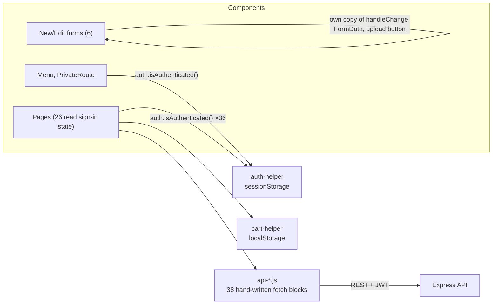
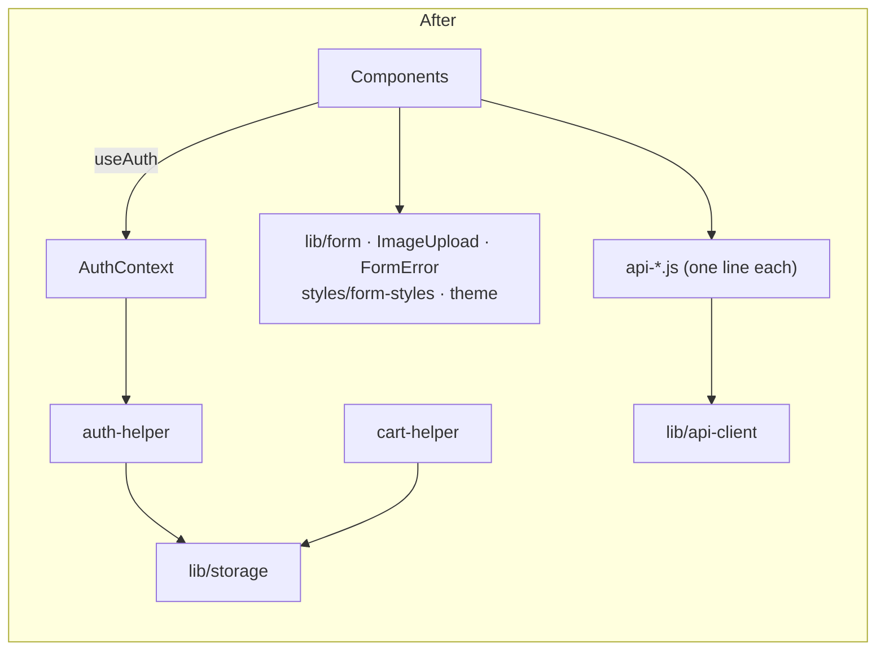

# Member C: client (React frontend)

## 1. Scope

This section covers everything under `client/`: the six `api-*.js` modules, the cart and sign-in storage helpers, how components learn who is signed in, the create/edit forms for shops, products and auctions, and component styling. Changes are on branch `refactor/client`, commits `4914bd8` through `37d588d`. The final metrics measure `c040f7e`. The server was not modified. A's and B's 88 server tests still pass unchanged.

## 2. Original design

At `baseline` (`bf3fc45`) the client is a React 16 single-page app with server-side rendering. `server/express.js` renders `MainRouter` to HTML, and `client/main.js` hydrates it in the browser. Each feature folder holds its components plus an `api-*.js` module that wraps `fetch`. Two module singletons hold browser state: `auth-helper` (the JWT in `sessionStorage`) and `cart-helper` (the cart in `localStorage`). Components call these directly.



Before (left) and after (right) of the client structure:



## 3. Defects and baseline evidence

References describe `baseline` and can be checked with `git show baseline:<path> | nl -ba`.

| ID | Defect | Evidence | Principle |
|---|---|---|---|
| D-09 | 38 API functions repeat the same fetch, headers, JSON parsing and try/catch | `client/shop/api-shop.js:1-15`, repeated in all six `api-*.js` files | DRY |
| D-10 | New/Edit forms duplicate their change handler, FormData building, upload button and error message. Auction date and countdown helpers are copied between components. `EditAuction.js` still names its component `EditShop`. | `client/shop/NewShop.js:59`, `:66`, `:93`, `:112`; `client/shop/EditShop.js:90`, `:106`, `:129`; `client/auction/NewAuction.js:47` / `EditAuction.js:71`; `Timer.js:17` / `Auctions.js:17`; `EditAuction.js:59` | DRY; naming |
| D-11 | 26 components read `sessionStorage` through `auth.isAuthenticated()` (36 calls; 28 and 38 after A's security fixes). Menu only reflects a sign-in because it re-renders on navigation. | `client/core/Menu.js:55-74`; `client/auth/PrivateRoute.js:7` | Single source of truth; coupling to storage |
| D-12 | Every cart and auth method repeats the `typeof window` check and the JSON parse/stringify | `client/cart/cart-helper.js:3`, `:12`, `:27`, `:36`, `:45`, `:55`; `client/auth/auth-helper.js:5-9`, `:14` | DRY |
| D-13 | The same card, text-field and submit style blocks are repeated in 9 forms. Colours are copied between files, and Menu hard-codes its link colours. | `client/shop/NewShop.js:16-39`; `client/user/Signup.js:19-41`; `client/core/Menu.js:14-25`; `client/cart/CartItems.js:68` / `client/order/Order.js:79` | DRY; theming |
| BUG-5 | Auction datetime values pad the month by testing the 0-based month, so October becomes `"010"` | `client/auction/NewAuction.js:50`; `EditAuction.js:74` | Correctness |

## 4. Method: tests before every change

The client had no tests. Before each refactor, a **characterization test** recorded what the existing code does. The refactor then had to keep that test passing.

| Test (commit) | What it records |
|---|---|
| `tests/client/api.test.js` (`4914bd8`) | For all 38 API functions: URL, method, Bearer token, body, Content-Type when a body is sent, abort signal, cookies (38 snapshots) |
| `tests/client/storage-helpers.test.js` (`73e6a39`) | The cart and auth helpers in a browser and during server rendering, including quirks such as `updateCart` throwing on an empty cart (14 tests) |
| `tests/client/pages.test.js` (`126a71f`) | Server-rendered HTML of 19 pages for a visitor, a signed-in buyer and a signed-in seller (57 snapshots), including redirects to sign-in |
| `tests/client/auction-time.test.js` (`5c4e19f`) | Date formatting for every month, and the countdown |

Two test-only commits made the page snapshots stable. `dc17e74` masks the current time pre-filled in New Auction. `0c46b35` masks Material-UI's generated class counters (`makeStyles-card-12`), which change when components are added. Both were re-recorded on the code **before** the next refactor, so they never hide a behaviour change.

## 5. Changes and evidence

### 5.1 D-09: shared API client (`31296a4`)

**Extract Function.** `client/lib/api-client.js` exports one `request(url, {method, credentials, json, formData, signal, withCookies})`. Each API function now states only what differs:

```js
// before: client/shop/api-shop.js (15 lines per function)
const remove = async (params, credentials) => {
  try {
    let response = await fetch('/api/shops/' + params.shopId, {
      method: 'DELETE',
      headers: { 'Accept': 'application/json', 'Content-Type': 'application/json',
                 'Authorization': 'Bearer ' + credentials.t }
    })
    return response.json()
  } catch(err) { console.log(err) }
}
// after
const remove = (params, credentials) =>
  request('/api/shops/' + params.shopId, {method: 'DELETE', credentials})
```

Exported names and parameters are unchanged, so no component changed. All 38 request snapshots pass. The six modules shrank from 624 to 183 SLOC, and their maintainability rose from 62.8–66.3 to 79.7–88.7.

**Deliberate differences.** Bodyless `GET` and `DELETE` requests no longer send `Content-Type: application/json`, which the server ignores. Four modules returned `response.json()` without `await`, so invalid JSON rejected the promise. All modules now behave like `api-user`: they log the error and resolve to `undefined`, the same as a network failure.

**Quality attributes.** Maintainability and modifiability: a header, base URL or error policy now changes in one place instead of 38.

### 5.2 D-12: shared JSON storage (`0e7b0e9`)

**Extract Module.** `client/lib/storage.js` provides `local` and `session` stores with `available()`, `read(key, fallback)`, `write` and `remove`. The `typeof window` check for server rendering lives there once. `cart-helper` and `auth-helper` keep their exact public API, and the 14 storage tests pass.

### 5.3 D-11: AuthContext (`211f765`)

**Introduce a context provider and hook.** `client/auth/AuthContext.js` holds `{jwt, signin, signout, updateUser}`, and every component reads `const {jwt} = useAuth()`. `AuthProvider` wraps `MainRouter` rather than `App`, because `server/express.js` renders `MainRouter` directly. Signing in, signing out and editing the profile go through the context, so its state always matches `sessionStorage`. Three components read the token inside an effect or handler; the read moved to the component body, because hooks only run at the top level.

The 57 page snapshots are identical for visitor, buyer and seller. That covers menu links, cart checkout buttons and redirects from protected pages.

**One ordering change.** In `DeleteUser`, the redirect is now set before signing out. Signing out re-renders Profile without the delete button, which would otherwise unmount `DeleteUser` before it could redirect. The user still lands on the home page, signed out.

**Quality attributes.** Lower coupling (components no longer know where the token is stored), a single source of truth, and testability.

### 5.4 D-10: shared form pieces (`ebf1e8a`, `c040f7e`)

**Extract Function / Extract Component:**
- `lib/form.js`: `useFormValues` (state plus the `handleChange` factory, including file inputs) and `toFormData(values, fields)`
- `components/ImageUpload.js`: hidden file input, button and file name
- `components/FormError.js`: the red error line, used by 9 forms
- `auction/auction-time.js`: the single copy of `calculateTimeLeft` and `getDateString`
- `EditAuction`'s component renamed from `EditShop`

Rendered markup is identical (page snapshots). Together with D-13, the six New/Edit pages lost 38–50 SLOC each. `Checkout` keeps its own error line: its icon has no style class, so the shared component would have changed how it looks.

### 5.5 BUG-5: October dates (`5c4e19f`)

Found while extracting `getDateString`. The regression test fails on the old code (`"2026-010-05T09:07"`) and passes after the fix (`String(n).padStart(2, '0')`). The fix is a separate `fix` commit, because it changes behaviour: in October, New Auction no longer starts with blank times, and Edit Auction shows the stored times.

### 5.6 D-13: styles and theme (`9b29161`)

**Extract constants / parameterize.** `styles/form-styles.js` provides `formCard(theme)`, `textField(theme, width)`, `submitButton(theme)` and `bigAvatar`, used by 9 forms. Class names are unchanged. `theme.js` gains `palette.navigation` (the Menu link colours) and `palette.marketplace` (8 colours that were copied across 9 files). Menu's two near-identical colour functions became one `linkColor`.

**Evidence:** 15 pages were rendered with `ServerStyleSheets` before and after this commit. All 4,473 generated CSS rules are identical (class counters ignored).

## 6. Metrics

Full tables are in [reports/final-c/SUMMARY.md](../reports/final-c/SUMMARY.md). The tools and formulas match [COMPARISON.md](../reports/COMPARISON.md), and the script reproduces B's published client figures.

| Client (area C) | Baseline | After A+B | After C |
|---|---:|---:|---:|
| Duplication (%) | 30.51 | 30.44 | **19.56** |
| Clone pairs | 63 | 63 | **43** |
| Avg maintainability | 69.22 | 69.17 | **71.66** |
| SLOC | 5206 | 5218 | **4690** |
| Whole-project duplication (%) | 13.53 | 12.52 | **8.07** |

| Structural count | Before | After |
|---|---:|---:|
| `fetch(` outside the API client | 38 | 0 |
| `auth.isAuthenticated()` in components | 38 | 0 |
| Colour literals in Menu | 4 | 0 |

## 7. Test evidence

| Measure | Before C | After C |
|---|---:|---:|
| Test suites | 11 | 15 |
| Tests | 88 | 205 |
| Snapshots | 0 | 95 |
| Failed | 0 | 0 |

`npm test` passes all 205 tests. Both production bundles build (`webpack.config.client.production.js`, `webpack.config.server.js`). The built app was started against a local MongoDB. All pages returned 200, and sign-up, sign-in, becoming a seller and creating a shop all worked through the refactored client modules.

## 8. Limits and future work

- Snapshot tests render on the server, so they cover first render, not later interaction. Interactive behaviour (the menu updating after sign-in, form submission, cart updates) was checked by hand in the browser.
- The largest remaining client clones are in list and order pages (`MyAuctions`/`OpenAuctions`/`Profile`, `CartItems`/`Order`, `ProductOrderEdit`). They were outside the five defects.
- `Auction.js`, `Auctions.js` and `Menu.js` remain unmeasured by Plato (parser limitation, the same as at baseline).
- Running locally needed `npm install --no-save @babel/core@7.29.0` (the same workaround as B) and, on Node 17+, `NODE_OPTIONS=--openssl-legacy-provider` for webpack 4.
